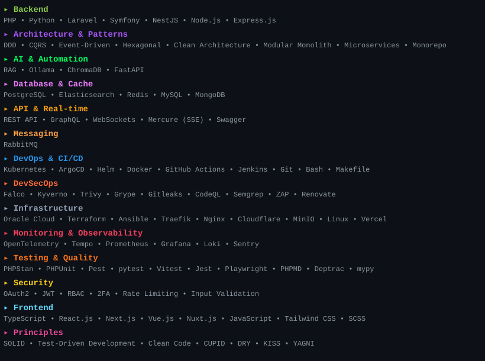
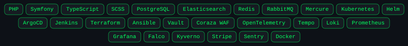
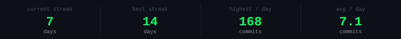

<div align="center">


</div>

## `> whoami`


## `> ssh developer-samuel@samuel-steiner.com`



<br/>

## `> cat about.txt`

```
Developer since 2017, focusing on backend engineering since 2019 - shipping
production systems since 2022, lately expanding into Platform Engineering,
DevOps, and DevSecOps: Kubernetes, GitOps, IaC, security scanning, and
AI-powered systems. Background across e-commerce platforms, financial and
investment systems, and field technician schedulers.

I care about architecture that ages well - Hexagonal DDD, clear boundaries,
code the next engineer can actually work with.

Looking for someone who can own a codebase end-to-end - architecture, DevOps,
code quality, and delivery? That's what I do. Let's talk about what you're building.
```

<br/>

## `> cat skills.json`



## `> gh repo list`

<details open>
<summary><b>LevelUp Store</b> &nbsp;&nbsp; <a href="https://github.com/developer-samuel/levelup-store"></a> <a href="https://levelup-store.samuel-steiner.com"></a></summary>

<br/>

Production-grade e-commerce monorepo - Symfony backend, Elasticsearch search, Stripe payments, RabbitMQ async processing, GitOps on k3s (Oracle Cloud, Terraform + Ansible), full CI/CD + supply chain security pipeline, and a companion AI assistant app. Hexagonal Architecture, DDD, CQRS, PHPStan level 10. Secrets: HashiCorp Vault + External Secrets Operator. Ingress: Coraza WAF + OWASP CRS. Supply chain: multi-arch builds, cosign keyless signing, SBOM (Syft), OSSF Scorecard. Observability: OpenTelemetry + Tempo, Loki, Prometheus + Grafana. Real-time updates via Mercure SSE.

<div align="center">



<br/>

<table>
<tr>
<td><a href="https://raw.githubusercontent.com/developer-samuel/levelup-store-screenshots/main/ecommerce/1.webp"></a></td>
<td><a href="https://raw.githubusercontent.com/developer-samuel/levelup-store-screenshots/main/ecommerce/2.webp"></a></td>
<td><a href="https://raw.githubusercontent.com/developer-samuel/levelup-store-screenshots/main/ecommerce/3.webp"></a></td>
</tr>
<tr>
<td><a href="https://raw.githubusercontent.com/developer-samuel/levelup-store-screenshots/main/ecommerce/4.webp"></a></td>
<td><a href="https://raw.githubusercontent.com/developer-samuel/levelup-store-screenshots/main/ecommerce/5.webp"></a></td>
<td><a href="https://raw.githubusercontent.com/developer-samuel/levelup-store-screenshots/main/ecommerce/6.webp"></a></td>
</tr>
<tr>
<td><a href="https://raw.githubusercontent.com/developer-samuel/levelup-store-screenshots/main/ecommerce/7.webp"></a></td>
<td></td>
<td></td>
</tr>
</table>

</div>

</details>

<br/>

<details open>
<summary><b>LevelUp Store • AI Assistant</b> &nbsp;&nbsp; <a href="https://github.com/developer-samuel/levelup-store"></a> <a href="https://levelup-store.samuel-steiner.com"></a></summary>

<br/>

Companion AI assistant from the LevelUp Store monorepo - answers questions about products, reviews, and user orders via a RAG pipeline (ChromaDB + Ollama), streams responses token-by-token via Redis pub/sub + SSE, processes requests through a RabbitMQ queue, and runs fully on-premise with no external API calls. Frontend features: microphone input, stop generation, auto-restore on reload, emoji support, and clear chat.

<div align="center">


<br/>

<table>
<tr>
<td><a href="https://raw.githubusercontent.com/developer-samuel/levelup-store-screenshots/main/assistant/1.webp"></a></td>
<td><a href="https://raw.githubusercontent.com/developer-samuel/levelup-store-screenshots/main/assistant/2.webp"></a></td>
<td><a href="https://raw.githubusercontent.com/developer-samuel/levelup-store-screenshots/main/assistant/3.webp"></a></td>
</tr>
<tr>
<td><a href="https://raw.githubusercontent.com/developer-samuel/levelup-store-screenshots/main/assistant/4.webp"></a></td>
<td><a href="https://raw.githubusercontent.com/developer-samuel/levelup-store-screenshots/main/assistant/5.webp"></a></td>
<td><a href="https://raw.githubusercontent.com/developer-samuel/levelup-store-screenshots/main/assistant/6.webp"></a></td>
</tr>
</table>

</div>

</details>

<br/>

## `> ls ./tools`

<table>
<thead>
<tr>
<th width="110">Project</th>
<th>Stack</th>
<th>What it is</th>
<th width="140">Links</th>
</tr>
</thead>
<tbody>

<tr>
<td width="110"><b>Ares Client</b></td>
<td></td>
<td>PHP client for the Czech ARES API (Administrative Register of Economic Subjects). Simple interface + CLI tool for Business ID lookups.</td>
<td width="140"><a href="https://github.com/developer-samuel/ares-client"></a>&nbsp;&nbsp;<a href="https://packagist.org/packages/developer-samuel/ares-client"></a></td>
</tr>

<tr>
<td width="110"><b>PHP CodeStats</b></td>
<td></td>
<td>Command-line tool for analyzing PHP source code metrics - files, lines, characters. Built for the kind of quick codebase audits.</td>
<td width="140"><a href="https://github.com/developer-samuel/php-codestats"></a>&nbsp;&nbsp;<a href="https://packagist.org/packages/developer-samuel/php-codestats"></a></td>
</tr>

</tbody>
</table>

<br/>

## `> gh api /users/developer-samuel`

<p align="center">
  
</p>

<p align="center">
  
</p>

<p align="center">
  
</p>

<br/>

## `> cat CONTACT.md`

<div align="center">


<br />

[](mailto:contact@samuel-steiner.com)

[](https://samuel-steiner.com)
[](https://links.samuel-steiner.com)
[](https://linkedin.com/in/samuel-programmer)
[](https://github.com/developer-samuel)
[](https://instagram.com/samuel.programmer)

[](https://github.com/sponsors/developer-samuel)

</div>
